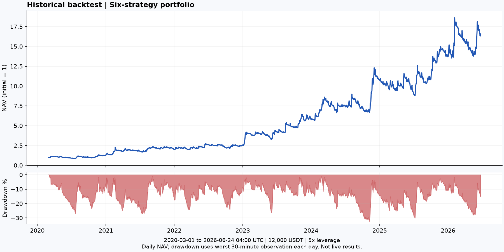
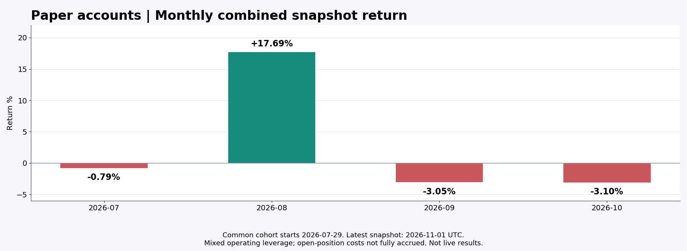

# 六策略量化表现

公开展示六个匿名策略的历史回测和持续运行的模拟盘月报。编号 **A—F** 在两类报告中保持一致，
不披露真实策略名称、信号规则、源代码或交易明细。最近更新：**2026-11-01**。

> **这是回测与模拟盘展示，不是实盘账户业绩，也不是收益承诺。**
> 历史回测总本金为 **12,000 USDT，5 倍杠杆**；模拟盘为六个各 10,000 USDT 的独立虚拟账户，
> 按实际运行参数分阶段记录。两者资金规模、配置、时段与核算口径不同，不能直接拼接成一条业绩曲线。

**参数变更：北京时间 2026-10-09 09:33，六组新开仓均已配置为 5 倍。** 保留原保证金投入规则，旧仓保持原杠杆并正常退出；历史收益未重算。跨越切换时点的月报包含新旧参数，不是全月纯 5 倍业绩。
[查看匿名参数变更记录](reports/parameter-changes.md)。

## 历史回测

主区间：**2020-03-01 至 2026-06-24 04:00 UTC**，截至已知资金费数据缺口前的边界估值。

| 指标 | 组合结果 |
| --- | ---: |
| 初始本金 | 12,000.00 USDT |
| 期末权益 | 197,868.84 USDT |
| 累计收益 | +1548.91% |
| 复合年化 CAGR | +55.88% |
| 最大回撤（30 分钟采样） | -32.65% |

| 期间 | 区间收益 | 区间内最大回撤 |
| --- | ---: | ---: |
| 2020（3 月起） | +29.29% | -26.96% |
| 2021 | +57.01% | -27.12% |
| 2022 | +26.15% | -24.39% |
| 2023 | +126.83% | -26.16% |
| 2024 | +85.41% | -32.65% |
| 2025 | +27.16% | -25.92% |
| 2026（截至 6/24） | +20.39% | -27.96% |

2020、2026 为不足一年的实际区间收益，不是全年收益，也没有强行年化。
主区间后存在未解决的历史资金费记录缺口；延长试算仅在[回测详情](reports/backtest.md)中作为参考列出。

## 模拟盘月度表现

按系统日快照统计，含持仓浮动价差；已实现费用已进入余额，但**未平仓费用没有全部预扣**。
最新为 **2026-11-01 日快照**，不是页面打开时的实时收益。
月度以 UTC 为准；月初快照通常于 00:07 UTC 采集，数据库日期标记为 00:00。

六账户共同可比区间从 **2026-07-29** 开始，当时合计权益
**58,640.96 USDT**。7 月组合行仅覆盖 7/29 至 8/1 月初快照；
各策略 7 月完整的启动以来表现，见[模拟盘月报](reports/paper-monthly.md)。

| 期间 | 组合收益 | 权益变动 USDT | 日快照最大回撤 |
| --- | ---: | ---: | ---: |
| 2026-07（起始不足整月） | -0.79% | -465.84 | -0.79% |
| 2026-08 | +17.69% | +10,289.36 | -2.61% |
| 2026-09 | -3.05% | -2,090.72 | -4.07% |
| 2026-10 | -3.10% | -2,055.77 | -5.67% |

模拟盘账户独立运行、未每日等权划转；组合收益按各账户权益相加计算，不是六个收益率的算术平均。
月度数据按 UTC 月边界结算；日采样回撤可能低估盘中最大回撤。

## 详细资料

- [匿名策略回测及逐年收益回撤](reports/backtest.md)
- [各策略每月收益、收益额与回撤](reports/paper-monthly.md)
- [计算口径、费用和局限](docs/methodology.md)
- [以后如何更新](docs/updating.md)
- [回测汇总数据](data/backtest.json) · [模拟盘月报数据](data/paper-monthly.json)

公开数据可用 `python scripts/verify.py` 核对汇总算术和文件哈希。
这不是策略源码库，不能凭公开汇总数据重跑原策略，也不构成第三方审计或交易建议。
